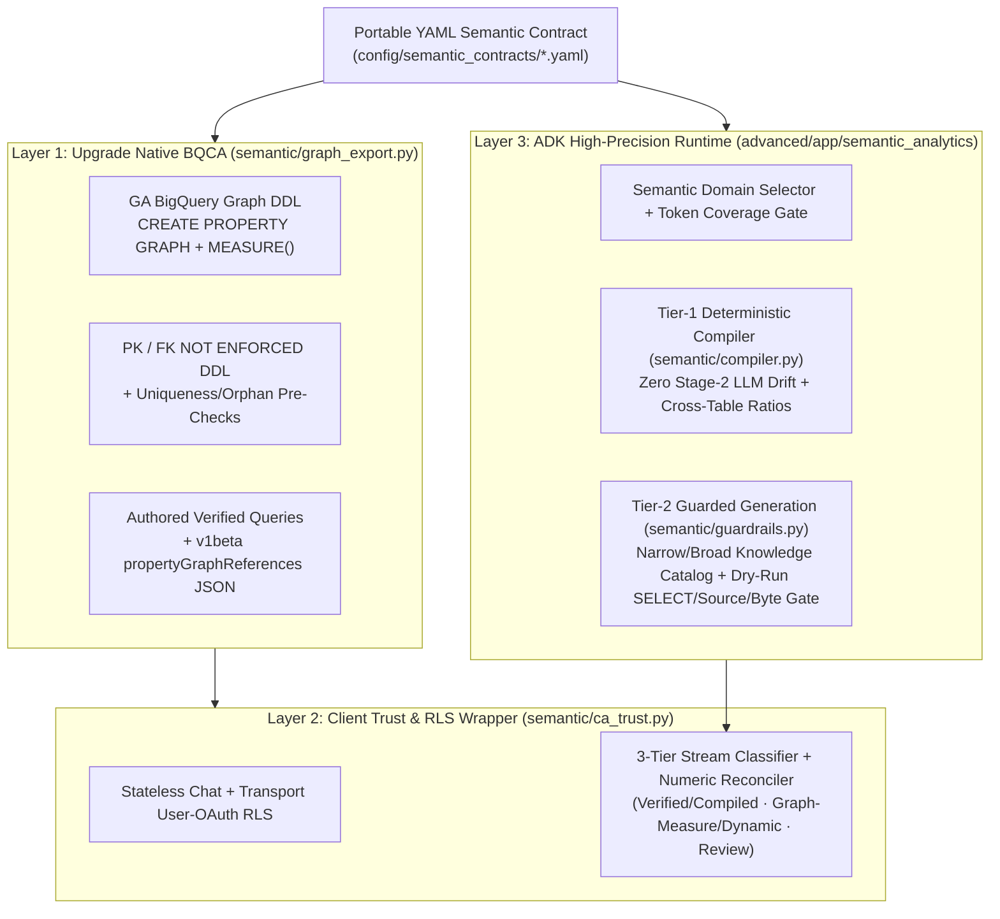

# High-Precision Agentic Analytics on BigQuery — Beyond Out-of-the-Box Conversational Analytics

`bq_caapi_ge` is a reference architecture and toolkit for delivering high-precision, enterprise-governed conversational analytics on BigQuery. While out-of-the-box **BigQuery Conversational Analytics (BQCA)** provides rapid, zero-infrastructure self-service exploration, enterprise applications require deterministic KPI precision, wide-schema routing (50+ tables), pre-execution SQL policy enforcement, client-verifiable stream trust, and transport-level user OAuth for Row-Level Security (RLS).

This repository demonstrates a **progressive 3-layer architecture** driven by a single source of truth: portable YAML semantic contracts (`config/semantic_contracts/*.yaml`).



For the comprehensive design rationale, architectural comparison matrix, and adoption guide, see [docs/architecture.md](docs/architecture.md).

---

## The 3-Layer Adoption Path

### Layer 1: Contract-Driven BQCA & Graph Measures Exporter
*Zero-code upgrade for native BigQuery Conversational Analytics.*
- Exports `CREATE OR REPLACE PROPERTY GRAPH ... MEASURE(...)` DDL utilizing official [BigQuery Graph Measures](https://docs.cloud.google.com/bigquery/docs/graph-measures).
- Generates `NOT ENFORCED` Primary and Foreign Key constraints with pre-flight uniqueness and orphan validation queries.
- Exports Verified Queries and `v1beta` `propertyGraphReferences` + `tableReferences` REST payloads.
- Run via `scripts/export_semantic_layer.py`.

### Layer 2: Stateless User-OAuth RLS & 3-Tier Stream Trust Wrapper
*Client-side governance and auditing library for any CA stream consumer.*
- Enforces user-scoped BigQuery RLS/CLS by passing user OAuth tokens over gRPC transport credentials (`DataAgentContext.credentials` is Looker-only).
- Classifies streaming response chunks into 3 Trust Tiers (`TIER_1_VERIFIED_OR_COMPILED`, `TIER_2_GROUNDED`, `TIER_3_REVIEW_REQUIRED`).
- Reconciles numerical claims in generated prose against raw returned BigQuery rows (`semantic/numeric_reconcile.py`).
- Implemented in `semantic/ca_trust.py`.

### Layer 3: Custom ADK High-Precision Runtime
*Autonomous, enterprise-grade multi-agent runtime for mission-critical analytics.*
- **Tier-1 Deterministic Compiler:** Resolves single-metric questions to exact GoogleSQL deterministically (`semantic/compiler.py`), eliminating Stage-2 SQL generation variance for covered single-metric intents.
- **Cross-Table Ratio Support:** Accurately computes multi-table ratios with unmatched denominator rows (e.g. `active_buyer_rate`) using join cardinality guards.
- **Knowledge Catalog Discovery:** Grounds exploratory questions in allowlisted BigQuery assets via Knowledge Catalog (`dataplex.googleapis.com`).
- **Pre-Execution Dry-Run Policy Gate:** Enforces `SELECT`-only execution, table allowlists, and per-query scan byte caps (`SQL_MAX_BYTES_BILLED`) before executing once.
- Implemented in `advanced/app/semantic_analytics/`.

---

## Project Structure

```text
├── config/
│   ├── semantic_contracts/         # Canonical YAML semantic contracts
│   │   ├── thelook_orders.yaml     # Orders domain metrics, dimensions & joins
│   │   └── thelook_inventory.yaml  # Inventory & catalog metrics & joins
│   ├── agent_definitions.py        # Baseline CA API agent definitions
│   ├── ca_locations.py             # CA API endpoint resolution by location
│   └── gcp_auth.py                 # Ambient and gcloud ADC token discovery
├── semantic/                       # Core semantic layer and trust evaluation
│   ├── compiler.py                 # Tier-1 deterministic SQL compiler & fan-out guards
│   ├── graph_export.py             # BigQuery Property Graph & PK/FK DDL generator
│   ├── guardrails.py               # Pre-execution dry-run SQL policy verifier
│   ├── ca_trust.py                 # Stateless streaming client & 3-tier trust classifier
│   ├── numeric_reconcile.py        # Prose-to-row numerical reconciliation
│   ├── sql_lex.py                  # GoogleSQL lexer and tokenizer
│   ├── catalog.py                  # Knowledge Catalog adapter & metadata search
│   ├── catalog_runtime.py          # ADK workflow nodes for Knowledge Catalog grounding
│   ├── runtime.py                  # ADK workflow nodes for semantic context selection
│   ├── sql_runtime.py              # ADK workflow nodes for guarded SQL generation
│   ├── registry.py                 # YAML contract loader & validation
│   ├── context.py                  # Context schemas and byte budget budgeting
│   ├── types.py                    # Contract data models & domain types
│   └── execution.py                # BigQuery executor with per-user OAuth & ADC modes
├── scripts/                        # Automation & baseline CA API tools
│   ├── export_semantic_layer.py    # CLI to export Graph DDL, FK constraints & VQ JSON
│   ├── enrich_bigquery_metadata.py # Run Knowledge Catalog profile and docs DataScans
│   ├── admin_tools.py              # Create/update baseline CA API data agents
│   └── register_ge_agents.py       # Register baseline CA API agents in Gemini Enterprise
├── advanced/                       # Custom ADK runtime & deployment
│   ├── app/
│   │   └── semantic_analytics/     # High-precision analytics ADK Workflow
│   │       └── evals/              # Native ADK evaluation benchmark suite
│   ├── scripts/
│   │   ├── deploy_agents.sh        # Deploy or stage agent for Vertex AI Agent Engine
│   │   ├── setup_auth.py           # Create OAuth authorization resource in GE
│   │   └── register_agents.py      # Register Agent Engine agent with Gemini Enterprise
│   ├── test_web/                   # Flask OAuth test harness with provenance display
│   └── README.md                   # Advanced runtime documentation
├── docs/
│   ├── architecture.md             # Complete architectural whitepaper & comparison matrix
│   └── eval-with-prism.md          # Evaluating CA data agents with Prism
├── .env.example                    # Environment configuration template
├── pyproject.toml                  # Project dependencies & build config
└── README.md
```

---

## Quick Start

### 1. Prerequisites
- Python 3.11+ with [`uv`](https://docs.astral.sh/uv/) package manager
- Google Cloud project with billing enabled
- Enabled Google Cloud APIs:
  - BigQuery API (`bigquery.googleapis.com`)
  - Conversational Analytics API (`geminidataanalytics.googleapis.com`)
  - Knowledge Catalog / Dataplex API (`dataplex.googleapis.com`)
  - Vertex AI API (`aiplatform.googleapis.com`)
  - Discovery Engine API (`discoveryengine.googleapis.com`)
- Authenticated `gcloud` credentials:
  ```bash
  gcloud auth application-default login
  ```

### 2. Installation
```bash
uv sync --extra advanced --extra web
```

### 3. Configuration
```bash
cp .env.example .env
```
Edit `.env` to configure your GCP project, region, and model settings.

---

## Layer 1: Exporting Semantic Contracts to BigQuery Graph

Export your YAML contracts as GA BigQuery Property Graph DDL, non-enforced foreign keys, and Verified Queries:

```bash
# Export GA Property Graph DDL with MEASURE() definitions
uv run python scripts/export_semantic_layer.py \
  --contract config/semantic_contracts/thelook_orders.yaml \
  --graph-project my-project \
  --graph-dataset analytics_graph \
  --format graph-ddl

# Export Primary Key & Foreign Key (NOT ENFORCED) DDL with validation checks
uv run python scripts/export_semantic_layer.py \
  --contract config/semantic_contracts/thelook_orders.yaml \
  --target-project my-project \
  --target-dataset analytics_curated \
  --format fk-ddl

# Export Verified Queries and v1beta DataSourceReference JSON
uv run python scripts/export_semantic_layer.py \
  --contract config/semantic_contracts/thelook_orders.yaml \
  --format verified-queries
uv run python scripts/export_semantic_layer.py \
  --contract config/semantic_contracts/thelook_orders.yaml \
  --graph-project my-project \
  --graph-dataset analytics_graph \
  --format datasource-json
```

*(Note: Exported Verified Queries use starter question templates that should be customized to match expected user prompt phrasings when used with `ca_trust`.)*

For more details on BigQuery Graph integration, see [BigQuery Graph Measures](https://docs.cloud.google.com/bigquery/docs/graph-measures) and [BigQuery Graph Chat](https://docs.cloud.google.com/bigquery/docs/graph-chat).

---

## Layer 2: Client Trust Classification & User OAuth RLS

Query conversational analytics endpoints using per-request transport-level user OAuth credentials for BigQuery RLS/CLS and 3-Tier trust classification (pair stateless requests with disabled Data Agent logging when server-side non-persistence is required):

```python
from semantic.ca_trust import (
    create_chat_client,
    build_stateless_chat_request,
    stream_stateless_chat,
    VerifiedQuerySpec,
)

# 1. Bind end-user OAuth token to transport credentials
client = create_chat_client(location="us", user_access_token=user_oauth_token)

# 2. Build stateless ChatRequest
request = build_stateless_chat_request(
    project_id="my-project",
    data_agent_name="projects/my-project/locations/us/dataAgents/order_user_agent",
    question="How many completed orders were placed?",
    location="us",
)

# 3. Stream and classify response into trust tiers
assessment = stream_stateless_chat(
    client=client,
    request=request,
    question="How many completed orders were placed?",
    authored_verified_queries=[
        VerifiedQuerySpec(
            question="How many completed orders were placed?",
            sql="SELECT COUNT(DISTINCT order_id) AS completed_orders FROM `bigquery-public-data.thelook_ecommerce.orders` WHERE status = 'Complete'",
            query_id="verified_completed_orders",
        )
    ],
)

print(f"Trust Tier: {assessment.tier.name}")
print(f"Sub-Mode:   {assessment.sub_mode}")
print(f"SQL:        {assessment.final_sql}")
print(f"Rows:       {assessment.result_rows}")
```

---

## Layer 3: Running the Custom ADK High-Precision Runtime

### Local Interactive Run
```bash
set -a; source .env; set +a
uv run --extra advanced adk run advanced/app/semantic_analytics
```

### Run Native ADK Evals
```bash
uv run --extra advanced --extra evaluation adk eval \
  advanced/app/semantic_analytics \
  advanced/app/semantic_analytics/evals/thelook_narrow.evalset.json \
  --config_file_path advanced/app/semantic_analytics/evals/eval_config.json \
  --print_detailed_results
```

### Run Local OAuth Test Web Harness
```bash
uv run --extra web python advanced/test_web/app.py
```
Open `http://localhost:8080` in your browser to test live OAuth user identity passthrough, query execution, and provenance inspection.

---

## Baseline OOTB BQCA & Gemini Enterprise A2A Utilities

For comparing custom runtime performance against baseline out-of-the-box BQCA:

1. **Enrich BigQuery Metadata via Knowledge Catalog DataScans:**
   ```bash
   uv run python scripts/enrich_bigquery_metadata.py --wait
   ```
2. **Create Baseline CA API Agents:**
   ```bash
   uv run python scripts/admin_tools.py
   ```
3. **Register Baseline Agents in Gemini Enterprise via A2A:**
   ```bash
   uv run python scripts/register_ge_agents.py \
     --agents order_user_agent inventory_product_agent \
     --auth-ids bq-caapi-oauth-orders bq-caapi-oauth-inventory
   ```

---

## Official Documentation References

- [BigQuery Graph Measures (GA)](https://docs.cloud.google.com/bigquery/docs/graph-measures)
- [BigQuery Graph Chat](https://docs.cloud.google.com/bigquery/docs/graph-chat)
- [Conversational Analytics API Overview](https://docs.cloud.google.com/gemini/data-agents/conversational-analytics-api/overview)
- [Conversational Analytics State Management](https://docs.cloud.google.com/gemini/data-agents/conversational-analytics-api/state-management)
- [Knowledge Catalog Data Insights for Structured Data](https://docs.cloud.google.com/knowledge-catalog/docs/data-insights-structured-data)
- [BigQuery Primary and Foreign Key Constraints](https://docs.cloud.google.com/bigquery/docs/primary-foreign-keys)

---

## License

Demonstration and reference architecture project for educational and technical enablement purposes.
