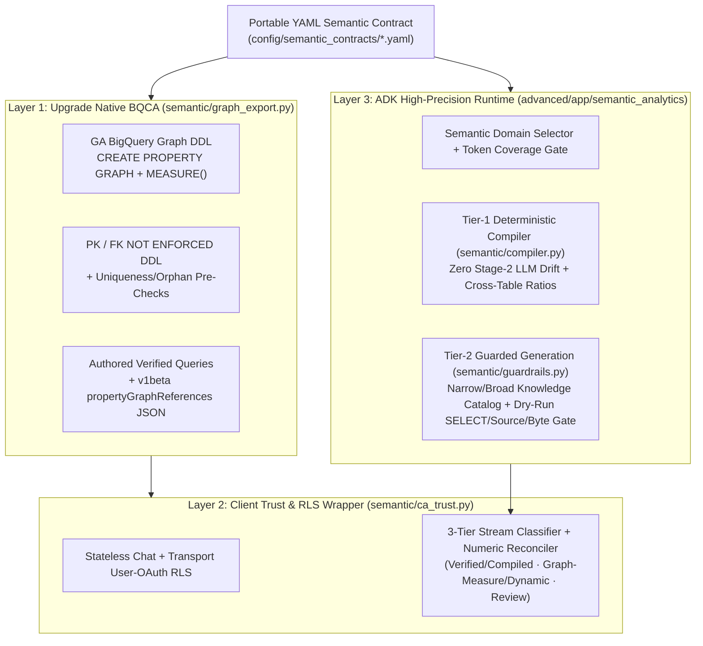

# High-Precision Agentic Analytics on BigQuery — Beyond Out-of-the-Box Conversational Analytics

`bq_caapi_ge` is an enterprise reference architecture and production toolkit for delivering high-precision, governed conversational analytics on BigQuery. While out-of-the-box **BigQuery Conversational Analytics (BQCA)** provides rapid, zero-infrastructure self-service exploration, enterprise applications require deterministic KPI precision, wide-schema routing (50+ tables), pre-execution SQL policy enforcement, client-verifiable stream trust, and transport-level user OAuth for Row-Level Security (RLS).

This repository implements a **progressive 3-layer architecture** driven by a single source of truth: portable YAML semantic contracts (`config/semantic_contracts/*.yaml`).



For the complete architectural design rationale, threat modeling, and comparison matrix, see [docs/architecture.md](docs/architecture.md).

---

## Start Here: Choose Your Layer

Select the layer that matches your organization's analytics governance and runtime needs:

| Customer Goal | Recommended Layer | Runtime Infrastructure Required | Key Entry Points & Assets |
| :--- | :--- | :--- | :--- |
| **Upgrade accuracy on existing native BQCA** without running or hosting custom agent code | **Layer 1** (Contract-Driven BQCA & Graph Exporter) | Zero custom compute; BigQuery & Conversational Analytics API only | `scripts/export_semantic_layer.py`<br/>`scripts/admin_tools.py`<br/>`scripts/validate_ca_agent.py` |
| **Add end-user or Role-SA RLS & 3-Tier trust badges** to native BQCA streams consumed by custom front-ends | **Layer 2** (Stateless Client Trust & RLS Wrapper) | Client library in your API gateway / BFF; no agent hosting | `semantic/ca_trust.py`<br/>`semantic/numeric_reconcile.py`<br/>`sql/zero_downtime_rls_pattern.sql` |
| **Eliminate KPI drift, support cross-table ratios (`active_buyer_rate`), route 50+ tables, and enforce pre-execution dry-run gates** | **Layer 3** (Custom ADK High-Precision Runtime) | Vertex AI Agent Engine or self-hosted ADK container | `advanced/app/semantic_analytics/`<br/>`semantic/compiler.py`<br/>`semantic/guardrails.py` |

---

## 5-Minute Interactive Walkthrough

Experience the difference between naive NL2SQL, native BQCA, and deterministic compilation in under 5 minutes. **Part 1 runs entirely in local Python memory with zero Google Cloud project setup or credentials required.**

```bash
# 1. Install dependencies
uv sync --extra advanced

# 2. Launch the interactive walkthrough notebook
uv run --with jupyter jupyter lab notebooks/beyond_bqca_walkthrough.ipynb
```

The walkthrough demonstrates:
1. **The Cross-Table Ratio Trap:** Why standard LLMs and default graphs silently distort ratios like `active_buyer_rate` by dropping non-purchasing users.
2. **Deterministic Tier-1 Compilation:** How `semantic/compiler.py` generates mathematically sound GoogleSQL with zero LLM variance.
3. **Pre-Execution Guardrails:** How dry-run validation blocks non-`SELECT` statements, unauthorized tables, and scan byte-cap overruns before running against BigQuery.
4. **3-Tier Stream Trust & Numeric Reconciliation:** How response streams are tagged with machine-readable trust badges and verified against raw data rows.

---

## Bring Your Own BigQuery Dataset to ADK in 4 Steps

Adapt this repository to your enterprise data warehouse in four straightforward steps:

### Step 1: Author a YAML Semantic Contract

Create a domain contract in `config/semantic_contracts/my_domain.yaml`. This declarative file serves as the single source of truth across all three layers:

```yaml
id: sales_domain
version: 1
owner: data-engineering@example.com
description: Sales transactions, customer profiles, and regional revenue metrics.
routing_terms: [orders, sales, revenue, average order value, customers]

tables:
  customers:
    source:
      project: my-corp-data-project
      dataset: enterprise_dw
      table: customers
    primary_key: customer_id
    grain: customer
  orders:
    source:
      project: my-corp-data-project
      dataset: enterprise_dw
      table: orders
    primary_key: order_id
    grain: order
    foreign_keys:
      customer_id: customers.customer_id

joins:
  customers__orders:
    left: customers
    right: orders
    "on": customers.customer_id = orders.customer_id
    relationship: one_to_many

dimensions:
  region:
    label: Customer Region
    description: Geographic operating sales region.
    table: customers
    sql: customers.region
    synonyms: [geography, territory]

metrics:
  total_revenue:
    label: Total Revenue
    description: Total completed net revenue from placed orders.
    synonyms: [sales, net revenue]
    type: sum
    base_table: orders
    sql: orders.total_amount
    required_filters:
      - orders.status = 'COMPLETED'
    allowed_dimensions:
      - region
    join_path:
      - customers__orders
    allowed_filters:
      region: ["=", "IN"]
```

### Step 2: Run & Test Locally with ADK

Configure your local environment and test queries using Application Default Credentials (ADC):

1. Set minimal configuration in `.env`:
   ```bash
   cp .env.example .env
   ```
   Ensure the following minimal variables are set:
   ```env
   GOOGLE_CLOUD_PROJECT=my-corp-data-project
   BIGQUERY_LOCATION=US
   SEMANTIC_CONTRACT_PATH=config/semantic_contracts
   CATALOG_ALLOWED_PROJECTS=my-corp-data-project
   CATALOG_ALLOWED_DATASETS=my-corp-data-project.enterprise_dw
   SQL_AUTH_MODE=adc
   ```

2. Authenticate locally:
   ```bash
   gcloud auth application-default login
   ```

3. Run the interactive ADK agent:
   ```bash
   uv run --extra advanced adk run advanced/app/semantic_analytics
   ```

4. Run the evaluation benchmark:
   *(Note: `thelook_narrow.evalset.json` is the bundled reference benchmark on `thelook_ecommerce`. Teams bringing their own semantic contract can author a matching `.evalset.json` and `gold_cases.yaml` tailored to their domain.)*
   ```bash
   uv run --extra advanced --extra evaluation adk eval \
     advanced/app/semantic_analytics \
     advanced/app/semantic_analytics/evals/thelook_narrow.evalset.json \
     --config_file_path advanced/app/semantic_analytics/evals/eval_config.json \
     --print_detailed_results
   ```

### Step 3: Choose & Configure Production Row-Level Security (RLS)

Choose the security architecture that matches your enterprise client application:

#### Option A: Gemini Enterprise / Google Workspace OAuth (`DEPLOY_SQL_AUTH_MODE=user`)
Use this mode when end-users access analytics directly through Gemini Enterprise, Google Workspace, or a custom OAuth web application:
- End-user Google OAuth bearer tokens are passed automatically per request via transport credentials.
- BigQuery evaluates Row-Level Security (`FILTER USING`) and Column-Level Security under the specific end-user's identity.
- Deploy to Vertex AI Agent Engine and register with Gemini Enterprise:
  ```bash
  # Deploy agent bundle to Agent Engine
  DEPLOY_SQL_AUTH_MODE=user bash advanced/scripts/deploy_agents.sh

  # Create OAuth authorization resource in Gemini Enterprise
  uv run python advanced/scripts/setup_auth.py --auth-id bq-caapi-oauth-semantic

  # Register deployed Reasoning Engine agent with Gemini Enterprise
  uv run python advanced/scripts/register_agents.py \
    --reasoning-engine <REASONING_ENGINE_RESOURCE_NAME> \
    --auth-id bq-caapi-oauth-semantic
  ```

#### Option B: Custom Portals / Slack / Teams / External IdP (`DEPLOY_SQL_AUTH_MODE=impersonated_sa`)
Use this mode when users authenticate via Okta, Ping, Azure AD, Microsoft Teams, Slack, or internal microservices where Google OAuth tokens are unavailable:
- **Zero-Secret Trust Chain:** The client portal or API gateway service account (`SQL_ROLE_TRUSTED_CALLER_SA`) signs a short-lived RS256 JWT assertion containing the verified user identifier and role slug (e.g. `apac_analyst`).
- **Signature Verification:** Agent Engine verifies the signature against Google's public x509 certificate endpoint (`https://www.googleapis.com/service_accounts/v1/metadata/x509/<caller_sa>`), extracting the `bqca_role` claim without storing any shared secrets or certificates in the agent.
- **Strict Role-SA Impersonation:** Agent Engine impersonates strictly the mapped Role Service Account (`SQL_ROLE_SA_MAP_JSON`), using `roles/iam.serviceAccountTokenCreator` granted on each specific Role SA (never project-wide).
- **2-Policy Zero-Downtime RLS:** Paired with [sql/zero_downtime_rls_pattern.sql](sql/zero_downtime_rls_pattern.sql), BigQuery enforces row filtering while preventing accidental table read lockouts.
- Deploy with impersonated SA support:
  ```bash
  DEPLOY_SQL_AUTH_MODE=impersonated_sa \
  SQL_ROLE_TRUSTED_CALLER_SA=gateway@my-project.iam.gserviceaccount.com \
  SQL_ROLE_SA_MAP_JSON='{"apac_analyst": "role-apac@my-project.iam.gserviceaccount.com", "emea_analyst": "role-emea@my-project.iam.gserviceaccount.com"}' \
  bash advanced/scripts/deploy_agents.sh
  ```

### Step 4: Audit Cost, Jobs & Stream Trust in Production

Continuously validate accuracy and track BigQuery compute consumption:

1. **Validate Agent Stream Trust & Trust-Tier Regression:**
   Test that queries return expected trust tiers and do not regress to ungrounded generation:
   ```bash
   # Verify queries stay within Tier 1 or Tier 2 (exit with error on Tier 3)
   uv run python scripts/validate_ca_agent.py \
     --project my-corp-data-project \
     --location global \
     --agent order_data_agent \
     --question "How many completed orders were placed?" \
     --max-tier 2
   ```

2. **Audit BigQuery Job Labels, Audit Logs & FinOps Costs:**
   Inspect live execution telemetry, scan bytes, and cost attribution across all BQCA and agent queries:
   ```bash
   uv run python scripts/verify_bqca_audit.py \
     --project my-corp-data-project \
     --bq-region region-us \
     --lookback-days 30 \
     --tib-rate-usd 6.25
   ```
   For specialized FinOps chargeback queries and reservation slot attribution, see [sql/bqca_audit_queries.sql](sql/bqca_audit_queries.sql).

---

## Google Cloud Location & Endpoint Alignment Table

To avoid regional routing errors, align your environment variables according to the table below:

| Environment Variable | Valid Values | Description & Routing Rules |
| :--- | :--- | :--- |
| `GOOGLE_CLOUD_LOCATION` | `global`, `us`, `eu`, `asia-southeast1` | **Conversational Analytics API endpoint location.** Single-region endpoints (such as asia-southeast1) can only query BigQuery datasets in that exact same region; cross-region routing or US/EU multi-region datasets require global, us, or eu. |
| `BIGQUERY_LOCATION` | `US`, `EU`, `us-central1`, `asia-southeast1` | **BigQuery dataset storage and query execution region.** When querying public datasets like `thelook_ecommerce`, this must match the public dataset's multi-region (`US`). |
| `AGENT_ENGINE_LOCATION` | `us-central1`, `europe-west1`, `asia-northeast1` | **Vertex AI Agent Engine deployment region.** Determines where the custom ADK Reasoning Engine is deployed and hosted. |
| `DATAPLEX_LOCATION` | `us-central1`, `europe-west1` | **Knowledge Catalog metadata scan region.** Knowledge Catalog DataScans require a specific regional location even when indexing multi-region BigQuery datasets (e.g. `us-central1` for `US` datasets). |
| `GEMINI_APP_LOCATION` | `global`, `us`, `eu` | **Gemini Enterprise (Discovery Engine) application location.** Matches the location where your enterprise agent or search application was provisioned. |

---

## Complete Project Structure

```text
bq_caapi_ge/
├── advanced/                       # Custom ADK runtime & deployment
│   ├── app/
│   │   └── semantic_analytics/     # High-precision analytics ADK Workflow
│   │       ├── agent.py            # Workflow nodes (compiler, guardrails, execution, synthesis)
│   │       └── evals/              # Native ADK evaluation benchmark suite
│   ├── docs/
│   │   └── examples/
│   │       └── chart_with_ca_api.py # Reference: direct CA API with chart support
│   ├── scripts/
│   │   ├── deploy_agents.sh        # Deploy or stage agent for Vertex AI Agent Engine
│   │   ├── register_agents.py      # Register Agent Engine agent with Gemini Enterprise
│   │   └── setup_auth.py           # Create OAuth authorization resource in Gemini Enterprise
│   ├── test_web/                   # Flask OAuth test harness with provenance display
│   │   ├── app.py                  # Flask application entry point
│   │   ├── static/
│   │   │   └── style.css           # Styling for test web UI
│   │   ├── templates/              # HTML templates (chat, index)
│   │   │   ├── chat.html
│   │   │   └── index.html
│   │   └── README.md               # Web harness documentation
│   └── README.md                   # Advanced runtime documentation
├── config/
│   ├── semantic_contracts/         # Canonical YAML semantic contracts
│   │   ├── thelook_inventory.yaml  # Inventory & catalog metrics & joins
│   │   └── thelook_orders.yaml     # Orders domain metrics, dimensions & joins
│   ├── agent_definitions.py        # Baseline CA API agent definitions
│   ├── ca_locations.py             # CA API endpoint resolution by location
│   └── gcp_auth.py                 # Ambient and gcloud ADC token discovery
├── docs/
│   ├── architecture.md             # Complete architectural whitepaper & comparison matrix
│   └── eval-with-prism.md          # Evaluating CA data agents with Prism
├── notebooks/
│   └── beyond_bqca_walkthrough.ipynb # 5-minute interactive walkthrough (no cloud setup for Part 1)
├── scripts/                        # Automation & baseline CA API tools
│   ├── admin_tools.py              # Create/update baseline CA API data agents
│   ├── enrich_bigquery_metadata.py # Run Knowledge Catalog profile and docs DataScans
│   ├── export_semantic_layer.py    # CLI to export Graph DDL, FK constraints & VQ JSON
│   ├── register_ge_agents.py       # Register baseline CA API agents in Gemini Enterprise
│   ├── validate_ca_agent.py        # Regression & trust-tier validator for CA Data Agents
│   └── verify_bqca_audit.py        # BigQuery job labels, audit logs & FinOps attribution
├── semantic/                       # Core semantic layer and trust evaluation
│   ├── ca_trust.py                 # Stateless streaming client & 3-tier trust classifier
│   ├── catalog.py                  # Knowledge Catalog adapter & metadata search
│   ├── catalog_runtime.py          # ADK workflow nodes for Knowledge Catalog grounding
│   ├── compiler.py                 # Tier-1 deterministic SQL compiler & fan-out guards
│   ├── context.py                  # Context schemas and token/byte budgeting
│   ├── execution.py                # BigQuery executor with per-user OAuth & ADC modes
│   ├── graph_export.py             # BigQuery Property Graph & PK/FK DDL generator
│   ├── guardrails.py               # Pre-execution dry-run SQL policy verifier
│   ├── numeric_reconcile.py        # Prose-to-row numerical reconciliation
│   ├── registry.py                 # YAML contract loader & validation
│   ├── rls_impersonation.py        # Signed role assertions & Role-SA impersonation
│   ├── runtime.py                  # ADK workflow nodes for semantic context selection
│   ├── sql_lex.py                  # GoogleSQL lexer and tokenizer
│   ├── sql_runtime.py              # ADK workflow nodes for guarded SQL generation
│   └── types.py                    # Contract data models & domain types
├── sql/                            # Production SQL reference patterns & queries
│   ├── bqca_audit_queries.sql      # INFORMATION_SCHEMA queries for BQCA jobs & cost
│   └── zero_downtime_rls_pattern.sql # 2-policy zero-downtime BigQuery RLS implementation
├── tests/                          # Complete automated test suite
│   ├── fixtures/
│   │   └── ca_streams/             # Wire recording fixtures for CA API streaming
│   ├── test_adk_workflow_compatibility.py
│   ├── test_admin_tools.py
│   ├── test_agent_definitions.py
│   ├── test_ca_locations.py
│   ├── test_ca_trust.py
│   ├── test_compiler.py
│   ├── test_enrich_bigquery_metadata.py
│   ├── test_graph_export.py
│   ├── test_guardrails.py
│   ├── test_rls_impersonation.py
│   ├── test_scripts_import.py
│   ├── test_semantic_analytics_agent.py
│   ├── test_semantic_catalog.py
│   ├── test_semantic_context.py
│   ├── test_semantic_evaluation.py
│   ├── test_semantic_sql.py
│   ├── test_sql_lex.py
│   ├── test_validate_ca_agent.py
│   ├── test_verify_bqca_audit.py
│   ├── test_walkthrough_notebook.py
│   └── test_web_app.py
├── .env.example                    # Environment configuration template
├── pyproject.toml                  # Project dependencies & build config
├── README.md                       # Main repository guide & customer onboarding
└── uv.lock                         # Locked dependency graph
```

---

## Layer-by-Layer Detailed Reference

### Layer 1: Contract-Driven BQCA & Graph Measures Exporter

Export your YAML contracts as GA BigQuery Property Graph DDL, non-enforced foreign keys, and Verified Queries:

```bash
# Export GA Property Graph DDL with MEASURE() definitions
uv run python scripts/export_semantic_layer.py \
  --contract config/semantic_contracts/thelook_orders.yaml \
  --graph-project my-corp-data-project \
  --graph-dataset analytics_graph \
  --format graph-ddl

# Export Primary Key & Foreign Key (NOT ENFORCED) DDL with validation checks
uv run python scripts/export_semantic_layer.py \
  --contract config/semantic_contracts/thelook_orders.yaml \
  --target-project my-corp-data-project \
  --target-dataset analytics_curated \
  --format fk-ddl

# Export Verified Queries and v1beta DataSourceReference JSON
uv run python scripts/export_semantic_layer.py \
  --contract config/semantic_contracts/thelook_orders.yaml \
  --format verified-queries

uv run python scripts/export_semantic_layer.py \
  --contract config/semantic_contracts/thelook_orders.yaml \
  --graph-project my-corp-data-project \
  --graph-dataset analytics_graph \
  --format datasource-json
```

*(Note: Exported Verified Queries use starter question templates that should be customized to match expected user prompt phrasings when used with `ca_trust`.)*

For more details on BigQuery Graph integration, see [BigQuery Graph Measures](https://docs.cloud.google.com/bigquery/docs/graph-measures) and [BigQuery Graph Chat](https://docs.cloud.google.com/bigquery/docs/graph-chat).

---

### Layer 2: Client Trust Classification & User OAuth RLS

Query conversational analytics endpoints using per-request transport-level user OAuth credentials for BigQuery RLS/CLS and 3-Tier trust classification (pair stateless requests with disabled Data Agent conversation logging when server-side non-persistence is required):

```python
from semantic.ca_trust import (
    create_chat_client,
    build_stateless_chat_request,
    stream_stateless_chat,
    VerifiedQuerySpec,
)

# 1. Bind end-user OAuth token to transport credentials
client = create_chat_client(location="us", user_access_token=user_oauth_token)

# 2. Build stateless ChatRequest
request = build_stateless_chat_request(
    project_id="my-corp-data-project",
    data_agent_name="projects/my-corp-data-project/locations/us/dataAgents/order_user_agent",
    question="How many completed orders were placed?",
    location="us",
)

# 3. Stream and classify response into trust tiers
assessment = stream_stateless_chat(
    client=client,
    request=request,
    question="How many completed orders were placed?",
    authored_verified_queries=[
        VerifiedQuerySpec(
            question="How many completed orders were placed?",
            sql="SELECT COUNT(DISTINCT order_id) AS completed_orders FROM `bigquery-public-data.thelook_ecommerce.orders` WHERE status = 'Complete'",
            query_id="verified_completed_orders",
        )
    ],
)

print(f"Trust Tier: {assessment.tier.name}")
print(f"Sub-Mode:   {assessment.sub_mode}")
print(f"SQL:        {assessment.final_sql}")
print(f"Rows:       {assessment.result_rows}")
```

---

### Layer 3: Running the Custom ADK High-Precision Runtime

#### Local Interactive Run
```bash
set -a; source .env; set +a
uv run --extra advanced adk run advanced/app/semantic_analytics
```

#### Run Local OAuth Test Web Harness
```bash
uv run --extra web python advanced/test_web/app.py
```
Open `http://localhost:8080` in your browser to test live OAuth user identity passthrough, query execution, and provenance inspection.

---

## Baseline Out-of-the-Box BQCA & Gemini Enterprise A2A Utilities

For comparing custom runtime performance against baseline out-of-the-box BQCA:

1. **Enrich BigQuery Metadata via Knowledge Catalog DataScans:**
   ```bash
   uv run python scripts/enrich_bigquery_metadata.py --wait
   ```
2. **Create Baseline CA API Agents:**
   ```bash
   uv run python scripts/admin_tools.py
   ```
3. **Register Baseline Agents in Gemini Enterprise via A2A:**
   ```bash
   uv run python scripts/register_ge_agents.py \
     --agents order_user_agent inventory_product_agent \
     --auth-ids bq-caapi-oauth-orders bq-caapi-oauth-inventory
   ```

---

## Official Documentation References

- [BigQuery Graph Measures (GA)](https://docs.cloud.google.com/bigquery/docs/graph-measures)
- [BigQuery Graph Chat](https://docs.cloud.google.com/bigquery/docs/graph-chat)
- [Conversational Analytics API Overview](https://docs.cloud.google.com/gemini/data-agents/conversational-analytics-api/overview)
- [Conversational Analytics State Management](https://docs.cloud.google.com/gemini/data-agents/conversational-analytics-api/state-management)
- [Conversational Analytics Audit Logging](https://docs.cloud.google.com/gemini/data-agents/conversational-analytics-api/audit-logging)
- [Knowledge Catalog Data Insights for Structured Data](https://docs.cloud.google.com/knowledge-catalog/docs/data-insights-structured-data)
- [BigQuery Primary and Foreign Key Constraints](https://docs.cloud.google.com/bigquery/docs/primary-foreign-keys)
- [BigQuery Row-Level Security Overview](https://docs.cloud.google.com/bigquery/docs/row-level-security-intro)
- [Managing BigQuery Row-Level Security](https://docs.cloud.google.com/bigquery/docs/managing-row-level-security)
- [Google Cloud Service Account Impersonation](https://docs.cloud.google.com/iam/docs/service-account-impersonation)

---

## License

Demonstration and reference architecture project for educational and technical enablement purposes.
