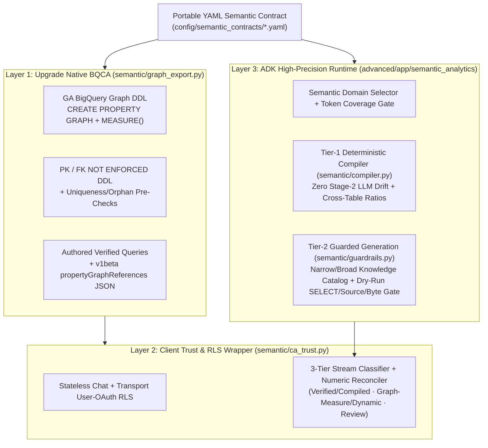

# Architecture: Beyond Out-of-the-Box BigQuery Conversational Analytics

This document details the architectural foundation of `bq_caapi_ge`, explaining why enterprise analytics requires going beyond default out-of-the-box BigQuery Conversational Analytics (BQCA), comparing alternative semantic approaches, and detailing the progressive 3-Layer adoption path.



---

## 1. Why Go Beyond Out-of-the-Box BQCA?

Out-of-the-box **BigQuery Conversational Analytics** (paired with **Knowledge Catalog** `LookupContext` and GA **Measures in BigQuery Graph**) offers a powerful, zero-infrastructure solution for exploratory data analysis across clean, well-indexed schemas without writing custom agent code.

However, enterprise production analytics routinely encounters four hard architectural boundaries where default BQCA alone is insufficient:

### A. Zero-Tolerance KPI Determinism & Cross-Table Ratios
Financial, executive, and regulatory metrics cannot tolerate LLM variance or non-deterministic SQL generation. Furthermore, complex business ratios frequently span multiple tables where denominator rows must not be filtered by numerator conditions.

For example, calculating `active_buyer_rate` across the eCommerce schema:
$$\text{active\_buyer\_rate} = \frac{\text{COUNT}(\text{DISTINCT CASE WHEN } \text{orders.status} = \text{'Complete' THEN } \text{orders.user\_id END})}{\text{COUNT}(\text{DISTINCT } \text{users.id})}$$

If an engine executes an `INNER JOIN` or starts a `GRAPH_EXPAND` traversal from the child `Orders` node (`start_node => "Orders"`), users with zero orders are dropped from the denominator, silently inflating the rate (for instance, counting only buyers who placed orders rather than all registered users). Graph `MEASURE()` definitions also require derived ratios (`SAFE_DIVIDE(AGG(m1), AGG(m2))`) to sit on a single element table rather than spanning `orders` and `users`.

### B. Multi-Domain Routing Across Wide Schemas (50+ Tables)
A native BQCA Data Agent Context Set is bounded to a focused collection of tables per agent to keep prompt context within high-precision boundaries and prevent join explosion. When an enterprise data warehouse contains dozens or hundreds of tables across domains (e.g., Sales, Inventory, Logistics, Marketing), an agent must partition schemas into modular semantic contracts and route questions deterministically before querying.

### C. Pre-Execution Runtime SQL Policy Enforcement
Native BQCA relies on server-side model constraints. Enterprise data governance mandates deterministic client/runtime boundary enforcement:
- Strictly `SELECT`-only execution (blocking DDL, DML, or data exfiltration attempts).
- Zero access to unapproved schemas (blocking `INFORMATION_SCHEMA` metadata snooping or system views).
- Strict table allowlists enforcing least-privilege data access.
- Hard pre-execution dry-run byte scan caps (`SQL_MAX_BYTES_BILLED`) before any job is submitted.

### D. Client-Verifiable 3-Tier Stream Trust & Per-User OAuth RLS
Downstream client applications need machine-readable provenance metadata: Did this answer execute a verified canonical query, a deterministically compiled contract, a grounded graph measure, or a dynamic exploratory attempt? Out-of-the-box endpoints do not tag stream confidence or reconcile numbers mentioned in model prose against the raw execution rows. Additionally, multi-tenant end-user Row-Level Security (RLS) requires scoped per-user OAuth tokens rather than service account delegation.

---

## 2. Architectural Comparison Matrix

| Capability | Out-of-the-Box BQCA | BigQuery Graph Measures ([GA](https://docs.cloud.google.com/bigquery/docs/graph-measures)) | Looker (LookML) | `bq_caapi_ge` (3-Layer Solution) |
| :--- | :--- | :--- | :--- | :--- |
| **Stage-2 SQL Author** | Cloud LLM (Conversational Analytics API) | Cloud LLM using `GRAPH_TABLE` / `GRAPH_EXPAND` | Looker SQL Generator (deterministic) | **Hybrid**: Deterministic Compiler (Tier 1) or Guarded LLM (Tier 2) |
| **Join Topology Limits** | LLM-inferred joins from table schema | Property graph node/edge schema; GRAPH_EXPAND traverses connected acyclic paths ([input limitations](https://docs.cloud.google.com/bigquery/docs/reference/standard-sql/graph-sql-queries#input_limitations)) | Central explore tree / symmetric aggregates | **Contract-defined DAG** with join cardinality guards & safe parent dimension filtering |
| **Cross-Table Ratios** | Model-generated SQL (join type not contract-pinned) | Single-element-table derived MEASURE() or custom SQL view | Supported via symmetric aggregate fan-out formulas | **Native support** via Tier-1 compiler (`LEFT JOIN` unmatched denominator preservation) |
| **Wide Schema Routing** | Single Data Agent Context Set | Single Property Graph scope | Model-selected explores | **Semantic Domain Selector** + Knowledge Catalog allowlisted broad search |
| **Runtime Guardrails** | BigQuery IAM/RLS & configurable query byte limits ([manage costs](https://docs.cloud.google.com/gemini/data-agents/conversational-analytics-api/manage-costs)) | BigQuery project quotas & IAM | Looker user permission sets | Pre-execution gate: SELECT-only syntax check, plus dry-run referenced_tables allowlist and scan byte cap when configured (enabled by default) |
| **Stream Trust & Auditing** | Natural language response | Natural language response | Fixed query hash & SQL inspection | **3-Tier Trust Assessment** + automated numeric reconciliation against result rows |
| **End-User RLS/CLS** | Supported in Gemini Enterprise via authorization resources | Project/table-level BigQuery permissions & RLS | Native Looker user attributes & RLS | **End-user OAuth passthrough in GE**, plus direct gRPC / per-request OAuth RLS (Layer 2 & Layer 3 `SQL_AUTH_MODE=user`) for custom apps |

---

## 3. Progressive 3-Layer Adoption Path

`bq_caapi_ge` is structured as three progressive, composable layers driven by a single source of truth: portable YAML semantic contracts (`config/semantic_contracts/*.yaml`).

```
config/semantic_contracts/*.yaml (Single Source of Truth)
   │
   ├──> Layer 1: Exporters (semantic/graph_export.py, scripts/export_semantic_layer.py)
   │      - GA BigQuery Property Graph DDL (CREATE PROPERTY GRAPH ... MEASURE(...))
   │      - Non-enforced Primary & Foreign Key DDL with pre-check validation queries
   │      - Authored Verified Queries & v1beta DataSourceReference JSON
   │
   ├──> Layer 2: Client Trust & RLS (semantic/ca_trust.py, semantic/numeric_reconcile.py)
   │      - Transport User-OAuth RLS (DataAgentContext.credentials isolation)
   │      - 3-Tier Stream Classifier & Automated Prose-to-Row Numeric Reconciler
   │
   └──> Layer 3: ADK High-Precision Runtime (advanced/app/semantic_analytics/)
          - Tier-1 Deterministic Contract Compiler (Zero LLM drift)
          - Tier-2 Knowledge Catalog Narrow/Broad Discovery + Pre-execution Dry-Run Gate
          - Numeric-reconciled final answer synthesis
```

### Layer 1: Contract-Driven BQCA & Graph Measures Exporter

Organizations already using or evaluating native BigQuery Conversational Analytics can upgrade their accuracy without deploying custom agent code.

- **Automated DDL Generation:** `scripts/export_semantic_layer.py` reads YAML contracts and outputs valid BigQuery GoogleSQL DDL:
  ```sql
  CREATE OR REPLACE PROPERTY GRAPH `my-project.analytics_graph.thelook_orders_graph`
    NODE TABLES (
      `bigquery-public-data.thelook_ecommerce.orders` AS Orders
        KEY (order_id)
        DEFAULT LABEL OPTIONS (description = 'order grain')
        PROPERTIES (
          order_id,
          user_id,
          status,
          MEASURE(COUNT(DISTINCT CASE WHEN (status = 'Complete') THEN order_id END)) AS completed_order_count
            OPTIONS (description = 'Number of distinct completed orders placed.')
        )
    )
    EDGE TABLES ( ... );
  ```
  Measures expose metrics directly on nodes, while edges are constructed strictly from valid `N:1` foreign key relationships following official [BigQuery Graph Measures](https://docs.cloud.google.com/bigquery/docs/graph-measures) and [BigQuery Graph DDL statements](https://docs.cloud.google.com/bigquery/docs/reference/standard-sql/graph-schema-statements).
- **Primary & Foreign Key Constraints:** Generates `NOT ENFORCED` PK/FK DDL preceded by dry-run uniqueness and orphan validation queries. Running the pre-flight uniqueness and orphan queries first helps catch join-key violations before declaring informational NOT ENFORCED join hints, which BigQuery does not enforce at write time and which can produce incorrect results if violated ([primary and foreign keys](https://docs.cloud.google.com/bigquery/docs/primary-foreign-keys)).
- **Verified Queries & Data Source References:** Generates canonical verified query definitions and `v1beta` `propertyGraphReferences` + `tableReferences` payloads ready for REST registration. Note that `export_verified_queries` emits starter `VerifiedQuerySpec` templates whose `question` strings teams should align with expected user phrasings when configuring `ca_trust`'s exact prompt+SQL allowlist.
- **Why Curated Contracts Outperform Automated DataScans:** Automated scans (such as `scripts/enrich_bigquery_metadata.py`) discover physical columns and profiles, but cannot distinguish primary business dimensions from noisy decoy columns (e.g., audit timestamps or internal tracking IDs). Curated YAML contracts restrict joins to intentional business paths. When benchmarking immediately after property graph DDL updates, disabling query result caching (`useQueryCache: false`) avoids serving cached pre-DDL query results.

### Layer 2: Stateless User-OAuth RLS & 3-Tier Stream Trust Wrapper

For applications consuming conversational streams from either native BQCA or custom agents:

- **User-Scoped Security:** In the Google Cloud CA API, `DataAgentContext.credentials` is reserved for Looker connections. Direct BigQuery execution passes end-user OAuth bearer tokens over the gRPC transport credentials channel so BigQuery Row-Level Security (RLS) and Column-Level Security (CLS) policies evaluate under the end-user's identity. Avoiding server-side row persistence in Layer 2 requires three joint controls: (1) stateless ChatRequest calls ([state management](https://docs.cloud.google.com/gemini/data-agents/conversational-analytics-api/state-management)), (2) Data Agent conversation logging disabled, and (3) the consuming client not persisting returned rows. In Layer 3 (advanced/app/semantic_analytics/), executed result rows are held in ADK session state for the active session so the answer synthesizer and provenance inspector can read them.
- **3-Tier Stream Trust Classification:** Streams are inspected chunk-by-chunk and categorized:
  - **Tier 1 (`TIER_1_VERIFIED_OR_COMPILED`):** The query matched an authored Verified Query (`AUTHORED_VERIFIED_QUERY`) or was compiled directly from the contract (`STRICT_CONTRACT_COMPILED`).
  - **Tier 2 (`TIER_2_GROUNDED`):** The query utilized GA Graph Measures (`GRAPH_MEASURE_GROUNDED`) or executed clean dynamic SQL without speculative assumptions (`DYNAMIC_SQL_GROUNDED`).
  - **Tier 3 (`TIER_3_REVIEW_REQUIRED`):** The response contained speculative assumptions, experienced an execution retry, failed prose-to-row numeric reconciliation, or represents a refusal/clarification (`CLARIFICATION_OR_REFUSAL`). (Layer 3 additionally downgrades truncated, empty, all-NULL, or zero-filtered-count results to Tier 3.)
- **Numeric Reconciliation:** `semantic/numeric_reconcile.py` heuristically extracts numerical claims from the assistant's prose and cross-checks them against the returned execution rows, flagging unreconciled prose numbers and downgrading stream trust to Tier 3.

### Layer 3: Custom ADK High-Precision Runtime

When applications demand deterministic accuracy, multi-domain routing, and rigorous safety controls, the ADK runtime in `advanced/app/semantic_analytics/` provides the complete solution:

1. **Semantic Concept Selection:** The model maps user intent to specific contract contexts, metrics, dimensions, and filter constraints.
2. **Code-Decided Tier-1 Fast-Path:** If the question maps to a single metric and context, all numeric and temporal tokens are accounted for, and all content tokens are verified, `semantic/compiler.py` deterministically compiles SQL directly from the YAML contract. This eliminates Stage-2 SQL generation variance for covered single-metric intents.
3. **Fan-Out & Filter Cardinality Protection:** The compiler verifies join cardinality. `1:N` steps are blocked for non-distinct aggregations, and on ratio metrics, filters on tables reached across a `1:N` step are rejected to prevent shrinking the base-table denominator.
4. **Narrow & Broad Knowledge Catalog Discovery:** If a question requires unmodeled tables, `semantic/catalog_runtime.py` performs default-deny allowlisted search via Knowledge Catalog (`dataplex.googleapis.com`), pulling only authorized BigQuery assets.
5. **Pre-Execution Dry-Run Policy Gate:** Whenever `allowed_sources` or `SQL_MAX_BYTES_BILLED` is configured (supplied on all shipped narrow/broad workflow paths and `.env.example`, alongside ADK's read-only `WriteMode.BLOCKED`), `semantic/guardrails.py` enforces single-statement `SELECT`-only syntax and performs a zero-cost BigQuery dry run verifying `referenced_tables` against the allowlist and enforcing `SQL_MAX_BYTES_BILLED`.
6. **Execution & Answer Synthesis:** The query executes once using the user's OAuth token (`SQL_AUTH_MODE=user`), results are formatted, numbers in prose are verified, and structured provenance metadata is returned to the client.
